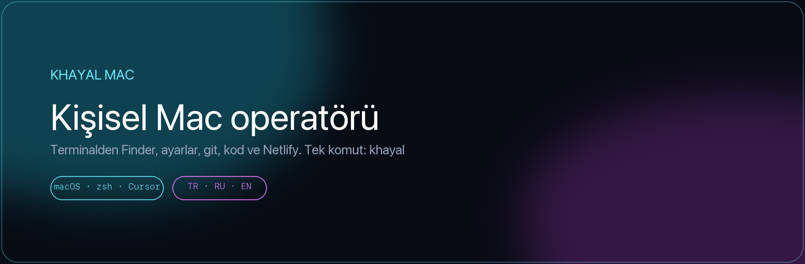

<div align="center">



<br/>

[](https://github.com/xeyal9032/khayal-mac)
[](https://github.com/xeyal9032/khayal-mac)
[](https://cursor.com)
[](https://github.com/xeyal9032/khayal-mac/releases/latest)
[](tests/e2e.zsh)
[](VERSION)

**Khayal Mac** — bu MacBook’un kişisel ajanı.  
Finder, Sistem Ayarları, proje iskeleti, dosya yazma, git, test, önizleme ve Netlify canlı yayın. Konuştuğun dilde cevap verir.

[Kurulum](#-kurulum) · [Kod yaz](#-kod-yaz) · [Menü 1–40](#-menü-140) · [Zip indir](https://github.com/xeyal9032/khayal-mac/releases/latest) · [Güvenlik](#-güvenlik)

</div>

---

## Kartlar

<table>
<tr>
<td width="33%" valign="top">

### Mac kontrol
Finder, Chrome, Wi-Fi, Dock, karanlık mod, kilit, ekran görüntüsü, pencere düzeni. Sistem Ayarları panellerinin tamamı.

`khayal finderı aç`  
`khayal ayar wifi`

</td>
<td width="33%" valign="top">

### Kod fabrikası
PHP, HTML, Node, Vite, Next iskeleti. Clone, `npm` / Composer, test, localhost önizleme. Yazılan kod terminalde görünür.

`khayal yeni vite uygulama`  
`khayal bak`

</td>
<td width="33%" valign="top">

### Git ve yayın
`git init` / remote / commit / push. GitHub bağlantısı. Netlify production — sadece sen `evet` deyince.

`khayal git kaydet`  
`khayal yayin yap evet`

</td>
</tr>
<tr>
<td width="33%" valign="top">

### Günlük rutin
Sabah özeti, yarın bildirimi, hatırlatma, Downloads klasörleme, temizlik planı, sağlık, şişen süreçler.

`khayal gunaydin`  
`khayal toparla`

</td>
<td width="33%" valign="top">

### Pano ve taslak
Pano geçmişi, Telegram/WhatsApp **taslak** (asla göndermez), Spotlight uygulaması, Option+Space kısayolu.

`khayal pano`  
`khayal taslak telegram ...`

</td>
<td width="33%" valign="top">

### Başka Mac + bakım
Zip, kurulum, `doctor` taraması, `demo` turu, GitHub’dan `guncelle`. Tab tamamlama. REPL’de sayı yaz: `21` = yeni proje.

`khayal doctor`  
`khayal menu`

</td>
</tr>
</table>

---

## Kod yaz

Sıfırdan site veya API. Klasör `$HOME/<ad>` altında açılır, git init edilir, Cursor açılır.

```bash
khayal yeni php restoran     # PHP iskeleti
khayal yeni html kart        # statik HTML
khayal yeni node api         # Node + test
khayal yeni vite uygulama    # Vite + React
khayal yeni next panel       # Next.js

khayal clone https://github.com/org/repo.git
khayal paketler              # npm / composer install
khayal testet                # proje testleri
khayal onizle                # http://127.0.0.1:8787
khayal bak                   # yazılan kodu göster
khayal git baglan            # GitHub repo
khayal yayin yap evet        # Netlify prod
```

Cümle de olur: `khayal index.php yaz login formu olsun` — ajan dosyayı **yazar**, yalnızca sohbete yapıştırmaz. Bittikten sonra terminalde `khayal bak` veya REPL’de `25`.

---

## Kurulum

<table>
<tr>
<td width="50%" valign="top">

### Kart 1 — Git clone (önerilen)

Yeni Mac’te Terminal:

```bash
git clone https://github.com/xeyal9032/khayal-mac.git \
  ~/.cursor/skills/khayal-mac

zsh ~/.cursor/skills/khayal-mac/scripts/install.sh
```

Yeni bir Terminal aç, sonra:

```bash
khayal help
```

</td>
<td width="50%" valign="top">

### Kart 2 — Zip ile kur

1. [Son sürümü indir](https://github.com/xeyal9032/khayal-mac/releases/latest) — `Khayal-Mac-Ajan.zip`
2. Terminal:

```bash
unzip ~/Downloads/Khayal-Mac-Ajan.zip -d /tmp
zsh /tmp/khayal-mac/scripts/install.sh
```

Bu Mac’ten zip üretmek:

```bash
khayal paketle
```

Masaüstüne `Khayal-Mac-Ajan.zip` yazar. AirDrop / USB yeter.

</td>
</tr>
</table>

### İlk açılış (bir kez)

| Adım | Komut / yer |
|---|---|
| 1. Cursor CLI | `curl https://cursor.com/install -fsS \| bash` |
| 2. Giriş | `agent login` |
| 3. İzinler | Sistem Ayarları → Gizlilik → **Erişilebilirlik** / **Otomasyon** |
| 4. Git (gerekirse) | `sudo xcodebuild -license accept` |

Kurulum skill’i `~/.cursor/skills/khayal-mac` altına koyar, `~/.zshrc` içine `khayal` komutunu ekler, Spotlight uygulamasını ve pano/sağlık daemons’larını yükler.

Aynı Mac’i yeniden kurmak: `khayal kur`

---

## Komutlar

| Komut | Ne yapar |
|---|---|
| `khayal` | Renkli sohbet (REPL) — sayı veya cümle |
| `khayal yeni php\|html\|node\|vite\|next <ad>` | Proje iskeleti |
| `khayal clone <url>` | GitHub’dan indir |
| `khayal paketler` | npm / Composer |
| `khayal testet` | Proje testleri |
| `khayal onizle` | localhost:8787 |
| `khayal bak` | Yazılan kodu göster |
| `khayal kod <proje>` | Çalışma klasörü |
| `khayal git durum\|init\|baglan\|kaydet\|gonder` | Git |
| `khayal yayin yap evet` | Netlify production |
| `khayal durum` | Pil · disk · Wi-Fi · ses |
| `khayal gunaydin` | Takvim + hava + pil |
| `khayal yan yana` | Chrome sol, Cursor sağ |
| `khayal duzenle` | Downloads’ı klasörle |
| `khayal paketle` | Başka Mac için zip |
| `khayal kur` | Bu Mac’e ajanı kur |
| `khayal doctor` | Ajan sağlık taraması |
| `khayal demo` | Wow turu (Mac’i bozmaz) |
| `khayal guncelle` | GitHub’dan güncelle |
| `khayal menu` | Komut paleti |
| `khayal e2e` | Test paketi |
| `khayal help` | Tam liste |

Cümle de olur: `khayal Downloads klasörünü aç` — ajan yapar.

---

## Menü 1–40

`khayal` yazınca sohbet açılır. Sayı yeter; `menu` paleti basar.

| # | Komut | # | Komut |
|---|---|---|---|
| 1 | durum | 21 | yeni (iskelet) |
| 2 | gunaydin | 22 | onizle |
| 3 | yarin | 23 | paketler |
| 4 | yan yana | 24 | testet |
| 5 | duzenle | 25 | bak (kod göster) |
| 6 | finder | 26 | diff |
| 7 | chrome | 27 | git durum |
| 8 | karanlik | 28 | git baglan |
| 9 | aydinlik | 29 | yayin |
| 10 | ss | 30 | kod |
| 11 | ss pdf | 31 | php (yeniphpfile) |
| 12 | kilitle | 32 | docker ps |
| 13 | saglik | 33 | doctor |
| 14 | sistir | 34 | demo |
| 15 | toparla | 35 | guncelle |
| 16 | uyku | 36 | paketle |
| 17 | pano | 37 | e2e |
| 18 | yapistir 1 | 38 | versiyon |
| 19 | ayar wifi | 39 | github |
| 20 | spotlight | 40 | help |

---

## Güvenlik

Onaysız **yapılmaz:** çöpü boşaltmak, Mac’i uyutmak, `rm -rf`, production Netlify, Telegram/WhatsApp **göndermek** (yalnızca taslak), `git config`, `git push --force`, `.env` / SSH anahtarı okumak.

`toparla evet` temizliği onaylar. `yayin yap evet` canlıya almayı onaylar.

---

## Test

```bash
khayal e2e
```

Kontrol edilen yollar (syntax, CLI, git sandbox, pano, ajanla PHP yazma, kurulum/paketleme) yeşil geçer. Çöp silme, Mac uyutma ve canlı Netlify testte kasıtlı atlanır.

---

<div align="center">

### Khayal · xeyal9032

[](https://github.com/xeyal9032)
[](https://frontend.ostwind.az/)


<br/>

<sub>Kişisel ajan · Khayal Jamilli · macOS</sub>

</div>
